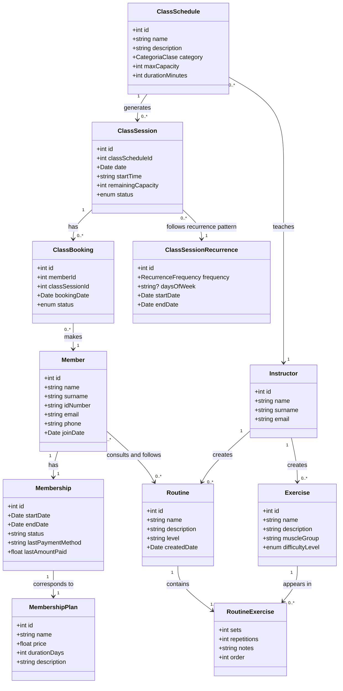

# Propuesta TP DSW

## Grupo

### Integrantes

- 53796 - Alodi, Milton (com 301)
- 54483 - Borda, Iael (com 301)
- 54449 - Martinez, Ramiro (com 301)
- 52665 - Mistraletti, Alejo (com 303)

### Repositorios

- [frontend app](https://github.com/RamiroM04/Front-TP-DSW)
- [backend app](https://github.com/RamiroM04/Back-TP-DSW)

## Tema

Sistema de gestión para gimnasio.

### Descripción

Sistema de gestión para un gimnasio que permite administrar socios, membresías, clases e instructores.
Los instructores crean rutinas de entrenamiento y dictan clases.
Los socios pueden consultar el estado de su membresía, explorar rutinas para su entrenamiento diario, y reservar o cancelar cupos en las clases grupales disponibles.
El personal administrativo gestiona altas de socios, planes, instructores y cobro de cuotas.

### Diagrama de clases

## Alcance Funcional

### Alcance Mínimo

Regularidad:

| Req               | Detalle                                                                                                                                                                                                                                                                                                                        |
| ----------------- | ------------------------------------------------------------------------------------------------------------------------------------------------------------------------------------------------------------------------------------------------------------------------------------------------------------------------------ |
| CRUD simple       | 1. CRUD Socio 2. CRUD Plan de Membresía 3. CRUD Instructor 4. CRUD Ejercicio                                                                                                                                                                                                                                          |
| CRUD dependiente  | 1. CRUD Membresía {depende de} CRUD Socio y CRUD Plan de Membresía 2. CRUD Rutina {depende de} CRUD Instructor y CRUD Ejercicio                                                                                                                                                                                             |
| Listado + detalle | 1. Listado de socios filtrado por estado de membresía (activo/vencido) y/o nombre, muestra nombre, DNI y estado => detalle muestra datos del socio y membresía vigente 2. Listado de Rutinas filtrado por nivel => detalle muestra datos completos de los ejercicios                                                        |
| CUU/Epic          | 1. Registrar nuevo socio y asignarle un plan de membresía 2. Reserva y cancelación de cupo en clases por parte del socio: el socio consulta sesiones disponibles y reserva su cupo; el sistema valida disponibilidad y descuenta el cupo en tiempo real. El socio puede además cancelar su reserva restituyendo la vacante. |

Adicionales para Aprobación:

| Req      | Detalle                                                                                                                                                                                                                                                                                                                                               |
| -------- | ----------------------------------------------------------------------------------------------------------------------------------------------------------------------------------------------------------------------------------------------------------------------------------------------------------------------------------------------------- |
| CRUD     | 1. CRUD Socio 2. CRUD Plan de Membresía 3. CRUD Instructor 4. CRUD Ejercicio 5. CRUD Horario y Sesión de Clase {depende de} CRUD Instructor 6. CRUD Membresía {depende de} CRUD Socio y CRUD Plan de Membresía 7. CRUD Rutina {depende de} CRUD Instructor y CRUD Ejercicio                                                         |
| CUU/Epic | 1. Registrar nuevo socio y asignarle un plan de membresía 2. Reserva y cancelación de cupo en clases por parte del socio con control de cupo en tiempo real 3. Crear y gestionar rutinas de catálogo con ejercicios parametrizados por parte del instructor 4. Registrar pago de membresía y renovar automáticamente la fecha de vencimiento |

### Alcance Adicional Voluntario

| Req      | Detalle                                                                                                                                                                                |
| -------- | -------------------------------------------------------------------------------------------------------------------------------------------------------------------------------------- |
| Listados | 1. Listado de actividades del día, muestra horarios, descripción, instructores, socios inscriptos y cupo restante 2. Socios con membresía próxima a vencer (en los próximos 7 días) |
| Otros    | 1. Integración con pasarela de pago externa (Mercado Pago / Stripe)                                                                                                                    |
